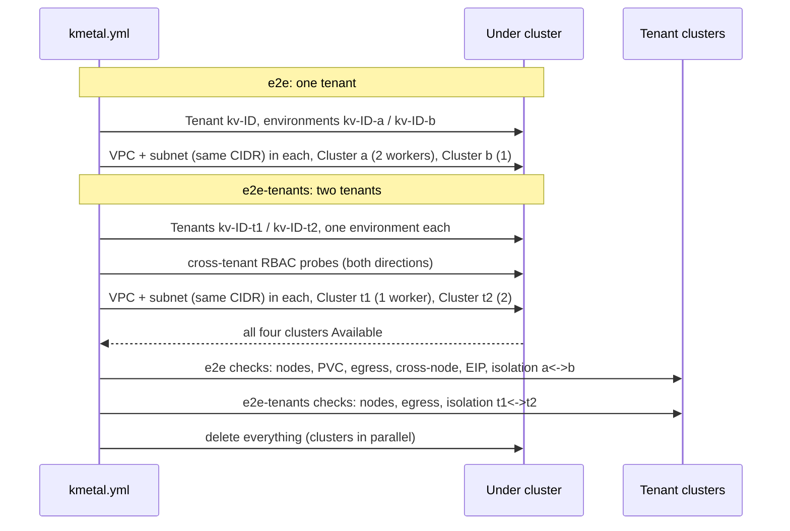

# End-to-end tests

[← Index](README.md)

Two end-to-end scenarios do what real tenants do, from onboarding to a published service. Both
prove that networks using the **same** CIDR stay isolated.

| Group | Scenario | Proves |
|---|---|---|
| `e2e` | **One tenant, two environments** (`a`, `b`), one cluster each | A tenant can run several environments on overlapping CIDRs; storage, egress, cross-node traffic and EIPs work |
| `e2e-tenants` | **Two tenants** (`t1`, `t2`), one environment and one cluster each | Multi-tenancy segregation: neither tenant owner can act on the other tenant, and the two VPCs on the same CIDR do not exchange traffic |

```bash
ansible-playbook -i inventory/<site> playbooks/kmetal.yml --tags e2e,e2e-tenants                  # both scenarios
ansible-playbook -i inventory/<site> playbooks/kmetal.yml --tags e2e-tenants                      # multi-tenancy only
ansible-playbook -i inventory/<site> playbooks/kmetal.yml --tags e2e,e2e-tenants -e kmv_keep=true # keep for inspection
```

Both groups are skipped when an earlier platform group failed (override:
`-e kmv_force_e2e=true`). The tasks live in `roles/e2e/tasks/`. When both run,
their four clusters boot **in parallel**, so the whole run takes about 25 to 45 minutes, mostly
waiting for tenant VMs.



## Inputs, read from the platform

The tests read their inputs from the platform; nothing is guessed:

| Input | Source |
|---|---|
| Tenant group | The first `spec.multiTenancy.users` entry of kind Group named `system:serviceaccounts:<ns>`; every test tenant owner is a ServiceAccount in `<ns>` |
| ClusterClass | `kmv_e2e_clusterclass`, or the first available of `kubevirt-standard`, `kubevirt-expert`, `kubevirt-kubeadm` |
| Kubernetes version | `kmv_e2e_k8s_version`, or the first `spec.clusterClass.values.osArtifact.tags` entry |
| OS image | The `OSArtifact` built for that tag; it must be Ready, with its `-golden` PVC Bound |
| Worker class | `spec.workers.machineDeployments[0].class` of the ClusterClass |
| Cluster API version | `cluster.x-k8s.io/v1beta2` when served, else `v1beta1` |

All objects are labelled `kmetal-validate/run-id=<id>`:

| Scenario | Tenant(s) | Environment namespace(s) | Cluster(s) | Workers |
|---|---|---|---|---|
| `e2e` | `kv-<id>` | `kv-<id>-a`, `kv-<id>-b` | `kv-<id>-a`, `kv-<id>-b` | `kmv_e2e_workers_a` (2), `kmv_e2e_workers_b` (1) |
| `e2e-tenants` | `kv-<id>-t1`, `kv-<id>-t2` | `kv-<id>-t1-env`, `kv-<id>-t2-env` | `kv-<id>-t1`, `kv-<id>-t2` | `kmv_e2e_tenant1_workers` (1), `kmv_e2e_tenant2_workers` (2) |

Each environment name starts with its tenant's name, so the tests also work where Capsule forces
a tenant prefix on namespaces.

## Shared building blocks

Both scenarios use the same task files, called once per environment with `loop`.

### Tenant (`tenant.yml`)

- Create the ServiceAccount `<tenant>` in the tenant group's namespace, creating that namespace
  if it is missing.
- Create the Capsule `Tenant` `<tenant>` (`capsule.clastix.io/v1beta2`), owned by
  `system:serviceaccount:<ns>:<tenant>`.
- Wait up to 120 s for it to be Ready.

### Environment (`env.yml`)

- The namespace is created with `kubectl create namespace` while **impersonating the tenant
  owner**. It must receive `capsule.clastix.io/tenant=<tenant>`.
- If the owner may not create SubnetClaims, it is reported as INFO; the claims are then applied
  as admin.
- The environment gets:
  - `VpcClaim main` with `externalAccess: true`;
  - `SubnetClaim primary` with `cidrBlock: <kmv_e2e_subnet_cidr>`, gateway on the first address,
    `attachment.managed: true` and `enableSnatRule: true`.
- Both claims must be Ready within 300 s. The router-port `EipClaim external` and its address
  are reported.

### Overlap (`subnets.yml`)

The two SubnetClaims of a scenario must map to two different Kube-OVN subnets, with the same
CIDR, in two different VPCs.

### Cluster (`cluster_apply.yml`)

One `Cluster` per environment, using only the variables the ClusterClass declares:

| Variable | Value |
|---|---|
| `controlPlane` | `dataStoreName: <kmv_e2e_datastore>`, `network.serviceType: LoadBalancer` |
| `machineSize` | `<kmv_e2e_machine_size>` |
| `osImage` | `artifactName: <OSArtifact for the version>` |
| `network` | `subnet: primary` (the SubnetClaim name) |

`version` is the chosen tag.

### Waiting (`wait_clusters.yml`)

All clusters of all selected scenarios are waited for together, by a single task that polls
every 15 seconds (`until`), up to `kmv_timeout_cluster` (default 30 minutes).
- A cluster is up when an `Available` or `Ready` condition is True and as many Machines as
  workers are `Running`.
- While it waits, the output shows `... still waiting (attempt N of M)` at the first attempt and
  every tenth (with `-v`, Ansible's `FAILED - RETRYING` lines: retries counting down, not
  errors).
- On timeout, the clusters, control planes, machines, VMIs and recent events of each cluster
  that did not come up are printed. The clusters that did come up are still tested.

### Tenant API access

Task file: `access.yml`.

- **Kubeconfig.** Read from `<cluster>-kubeconfig`. Its internal server address is rewritten to
  the Kamaji LoadBalancer address, which must lie in `loadBalancer.tenantControlPlanes` (WARN
  otherwise).
- **Path to the API**, chosen by `kmv_tenant_access`:

| Mode | Behaviour |
|---|---|
| `direct` | `kubectl` runs on the bootstrap machine, with the kubeconfig in a temporary file (mode 0600) |
| `ssh` | `kubectl` runs on `kmv_tenant_kubectl_node` (default: the first control plane), through `delegate_to`. The kubeconfig is written to a temporary file (mode 0600) on that node |
| `auto` | `direct` when `https://<lb>/healthz` answers from the bootstrap machine, otherwise `ssh` |

In `ssh` mode, the reachability of the tenant API from a control plane is itself checked: it
proves the tenant VLAN and the MetalLB L2 advertisement work. The temporary kubeconfigs are
removed in an `always` block at the end of the role.

### Network isolation (`overlap.yml`, `isolation.yml`)

**Worker addresses** of a cluster are its nodes' InternalIPs and its VMIs' interface addresses
inside `kmv_e2e_subnet_cidr`. For each pair of clusters:
- Both address sets are printed. Identical addresses in both prove the overlap.
- Isolation is probed **in both directions**. From cluster X, a pod connects to port 10250 of a
  worker address that Y uses and X does not, so a reply could only come from Y's VPC.
- A connection is a FAIL: the VPCs are not isolated.
- When every address of Y is also used by X, that direction cannot be probed and is reported as
  INFO. This is why each scenario's two clusters have **different worker counts** by default.

## Scenario `e2e`: one tenant, two environments

1. Create tenant `kv-<id>` and environments `a` and `b`, each with its VPC and subnet on the
   same CIDR; then check the overlap.
2. Create cluster `a` (2 workers) and cluster `b` (1 worker).
3. Inside each cluster:

| Check | How | Severity |
|---|---|---|
| Nodes Ready | the expected number of nodes Ready within 15 minutes | FAIL, with the Sveltos `clustersummaries` (CNI delivery) as a hint |
| Storage | PVC on the default class (`kubevirt`) plus a writer pod, within 7 minutes | FAIL |
| Storage backing | the under-cluster PVC carrying the tenant PVC's UID uses `tenantClassName` | FAIL; WARN when none is found |
| Egress | a pod fetches `kmv_internet_probe_url`: VM, then subnet, then VPC router, then SNAT on the provider network | FAIL |
| Worker spread (`a`) | the worker VMIs run on different hosts | WARN when on one host |
| Cross-node traffic (`a`) | two nginx pods with anti-affinity; a pod on one worker fetches from the other's pod IP | FAIL |

4. EIP, in environment `a`:

| Check | How | Severity |
|---|---|---|
| Claim | `EipClaim e2e` (`type: nat`) Ready within 180 s | FAIL |
| Binding | a tenant `LoadBalancer` Service with `loadBalancerClass: kmetal` and annotation `network.kmetal.io/eip-claim: e2e` gets the claim's address within 300 s | FAIL |
| Bound | the claim's `BOUND` column is true | WARN |
| Reachable | `http://<eip>/` fetched from `kmv_eip_probe_from` | WARN: provider routing is site-specific |

5. Network isolation between `a` and `b`, both directions.

## Scenario `e2e-tenants`: two tenants

1. Create tenants `kv-<id>-t1` and `kv-<id>-t2`, each with one environment owned by its own
   ServiceAccount.
2. **Cross-tenant permissions**, in both directions. Using `kubectl auth can-i` while
   impersonating one tenant's owner, ten actions are probed against the other tenant:

| Probed action | Target |
|---|---|
| `get pods`, `create pods` | the other tenant's environment |
| `get secrets`, and `get secrets/<cluster>-kubeconfig` | its Secrets, and the tenant cluster's admin kubeconfig |
| `get clusters.cluster.x-k8s.io` | its tenant clusters |
| `create vpcclaims`, `subnetclaims`, `eipclaims` (`network.kmetal.io`) | its network |
| `delete namespaces/<env>` | the environment itself |
| `update tenants.capsule.clastix.io/<tenant>` | the other Tenant |

   - Any allowed action is a FAIL that lists the leaks.
   - As a control, the owner must be able to read pods in its **own** environment. If it
     cannot, a WARN says the denials prove little.

3. Each environment gets a VPC and a subnet on the same CIDR; then the overlap is checked.
4. Create cluster `t1` (1 worker) and cluster `t2` (2 workers).
5. Inside each cluster: nodes Ready, and egress through the tenant's own VPC router and SNAT.
6. Network isolation between `t1` and `t2`, both directions.

## Cleanup

The cleanup runs at the end of `kmetal.yml`, also after a failed task (`always`), but not
after Ctrl-C:
1. the tenant Service `web`, which unbinds the EIP;
2. the temporary tenant kubeconfigs;
3. every Cluster of the run, deleted together so they go down in parallel, waited for up to
   20 minutes;
4. the EipClaims, SubnetClaims and VpcClaims;
5. the namespaces: environments, the temporary namespace, and the tenant-group namespace if
   the test created it;
6. the Tenants and their ServiceAccounts.

After Ctrl-C, run `playbooks/cleanup.yml -e kmv_run_id=<id>`.

See [Resources and cleanup](resources-and-cleanup.md).

## Requirements

- At least one `system:serviceaccounts:<ns>` group in `spec.multiTenancy.users`.
- A Ready `OSArtifact` with a Bound golden PVC for the chosen version.
- Capacity, with both scenarios: 6 worker VMs and 4 hosted control planes.
- Free addresses, with both scenarios:
  - 4 in the tenant pool (the tenant API servers);
  - 5 on the provider network (four router ports and one EIP).
- The test images reachable from the tenant VMs (`kmv_test_image`, `kmv_probe_image`,
  `kmv_curl_image`).
