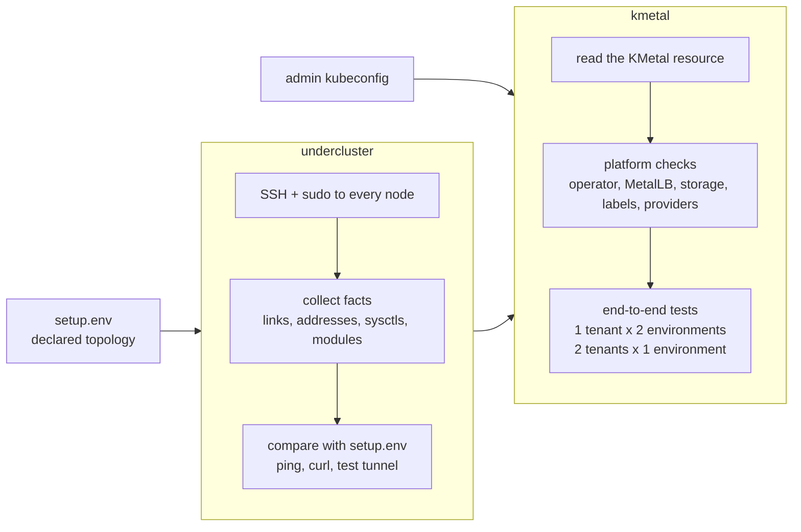

# Overview

[← Index](README.md)

## Purpose

A kMetal installation depends on a correctly prepared under cluster: the right VLANs on the
right nodes, non-overlapping address plans, a working overlay, controlled internet egress, the
correct node labels, and storage classes that can snapshot. When one of these is wrong, the
platform often installs and reports healthy, but tenant clusters fail later in ways that are
hard to trace back.

`kmetal-validate` turns the installation requirements and the platform validation procedure of
kMetal 1.0.0 into one repeatable command. A support engineer runs it from a bootstrap machine:
- before installing kMetal, to prove the under cluster is ready;
- after installing it, to prove the platform works for a real tenant.

## Two phases

| Phase | Command | Source of truth | Reaches |
|---|---|---|---|
| Under cluster | `undercluster` | `setup.env`: the topology the customer declared | Every node, over SSH |
| Platform | `kmetal` | The live `KMetal` resource (`kubectl get km`) | The under cluster API; nodes over SSH when `setup.env` is present |

The phases are independent. `undercluster` needs no kubeconfig; when one works, it also
cross-checks the node list and address plan against the cluster. `kmetal` needs no `setup.env`;
when one is present, it adds the checks that need SSH: interfaces on the nodes, the tenant API
reached from the tenant VLAN, and EIP reachability.

## Design principles

- **Data-driven.** Nothing site-specific is hard-coded. Expected values come from `setup.env`
  (under cluster) or from the `KMetal` resource's `.spec` (platform): class names, address
  pools, central nodes, provider networks, image tags, tenancy subjects, placement.
- **One self-contained file.** A single bash script, easy to copy to a customer's bootstrap
  machine. Its only local dependencies are standard tools (`ssh`, `jq`, `curl`, `kubectl`,
  `helm`).
- **Every check is a verdict.** Each result is PASS, WARN, FAIL or INFO with a sentence saying
  what was found. A failed check never stops the run; the summary lists every FAIL and WARN.
- **Leave no trace.** Every object the tool creates carries a run ID label and is deleted on
  exit, including after Ctrl-C. Changes on the nodes are limited to a test tunnel device that
  lives a few seconds. See [Resources and cleanup](resources-and-cleanup.md).
- **Version-scoped.** The rules follow the kMetal **1.0.0** documentation. The operator chart
  version is read, and anything other than `1.0.x` is a WARN.

## Severities

| Level | Meaning | Effect on exit code |
|---|---|---|
| PASS | The requirement is met | none |
| WARN | Works, but deviates from the recommended setup, or could not be fully verified | `2` if there is no FAIL |
| FAIL | A requirement is not met; tenant workloads will break or the platform is unhealthy | `1` |
| INFO | Context: a decision the tool made, or an expected deviation | none |

## Design decisions

Where a requirement could be read more than one way, the tool follows the kMetal 1.0.0
documentation:

| Topic | Behaviour | Why |
|---|---|---|
| Worker OS images | Read from `spec.clusterClass.values.osArtifact.tags` | The field path in the `KMetal` resource |
| `kube-ovn/role=master` | Checked on `spec.networking.kubeOVN.centralNodes`, ideally the three control planes | It is ovn-central's nodeSelector |
| Overlay on control planes | INFO when absent | Control planes are not network nodes; Kube-OVN's tunnel runs on the network nodes (`node-role.kubernetes.io/network`, the workers) only |
| Minimum size | Fewer than 1 control plane + 2 workers is a FAIL; fewer than 3 control planes is a WARN | The documented production layout has 3 control planes |
